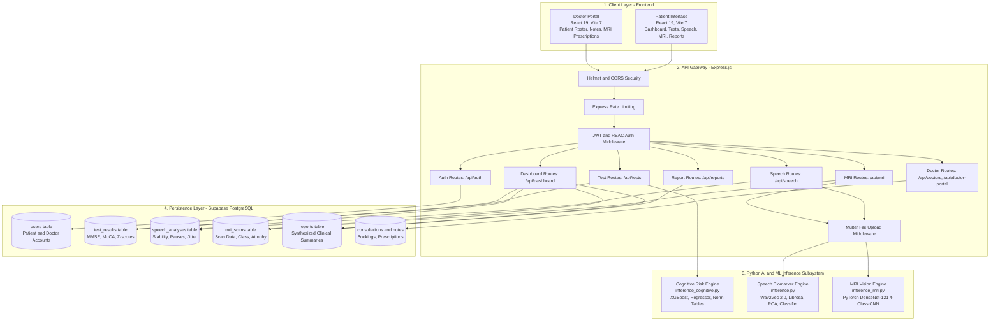
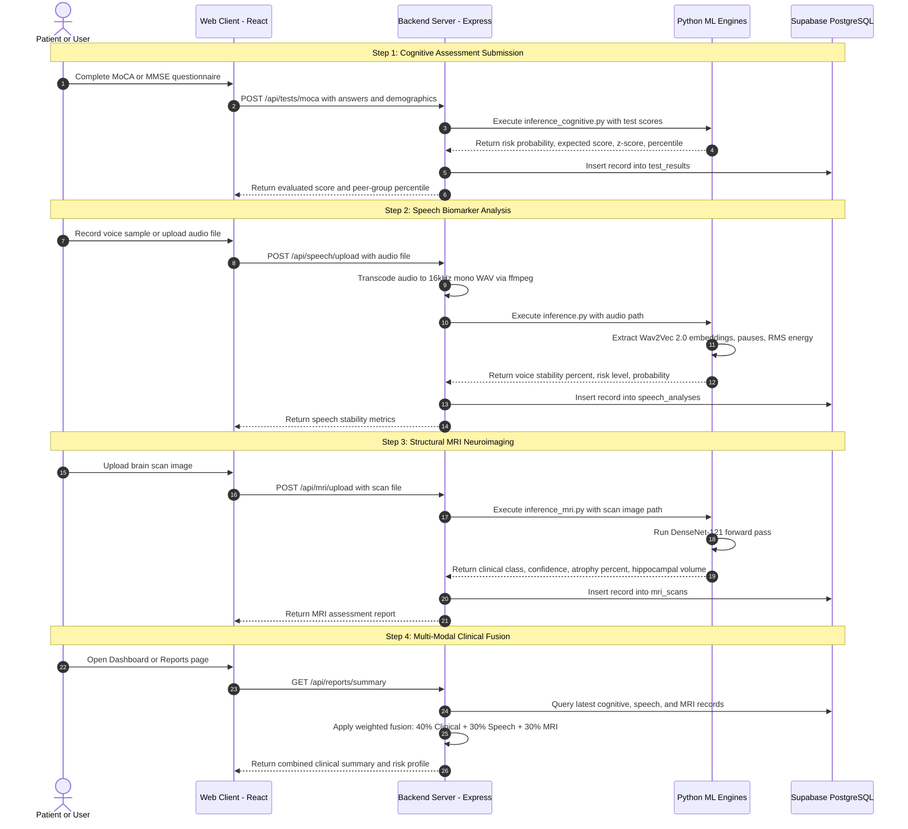

# 🧠 NeuroLens (CogniFusion)
### Multi-Modal AI Cognitive Health & Early Dementia Screening Platform

[](https://nodejs.org/)
[](https://react.dev/)
[](https://vitejs.dev/)
[](https://pytorch.org/)
[](https://supabase.com/)
[](LICENSE)

---

## 📑 Table of Contents
1. [Executive Summary](#-executive-summary)
2. [Problem Statement](#-problem-statement)
3. [Available Current Solutions & Limitations](#-available-current-solutions--limitations)
4. [Our Proposed Solution: NeuroLens](#-our-proposed-solution-neurolens)
5. [Key System Features](#-key-system-features)
6. [Complete Architecture Flow](#-complete-architecture-flow)
   - [High-Level System Architecture](#1-high-level-system-architecture)
   - [Multi-Modal Inference & Fusion Pipeline](#2-multi-modal-inference--fusion-pipeline)
   - [Dual-Portal User Journeys](#3-dual-portal-user-journeys-patient-vs-doctor)
7. [Tech Stack](#-tech-stack)
8. [Machine Learning Models & Empirical Metrics](#-machine-learning-models--empirical-metrics)
9. [Repository & Directory Structure](#-repository--directory-structure)
10. [Step-by-Step Installation & Setup](#-step-by-step-installation--setup)
11. [Common Issues & Troubleshooting](#-common-issues--troubleshooting)
12. [API Endpoints Reference](#-api-endpoints-reference)
13. [Outputs & Clinical Deliverables](#-outputs--clinical-deliverables)
14. [Security, Ethics & Clinical Disclaimer](#-security-ethics--clinical-disclaimer)
15. [Future Scope & Roadmap](#-future-scope--roadmap)
16. [Conclusion](#-conclusion)
17. [Reference Pages & Academic Literature](#-reference-pages--academic-literature)

---

## 🌟 Executive Summary

**NeuroLens** (internally designated *CogniFusion*) is an end-to-end, multi-modal digital health platform built for the **early detection, longitudinal monitoring, and clinical decision support of cognitive decline and dementia risk** (such as Alzheimer's Disease and Mild Cognitive Impairment).

By synthesizing **demographically adjusted neuropsychological assessments** (MMSE, MoCA, Clock Drawing, Trail Making), **acoustic speech biomarkers** (Wav2Vec 2.0 embeddings + prosody metrics), and **structural neuroimaging** (DenseNet-121 convolutional networks on brain MRI scans), NeuroLens delivers an objective, 360-degree cognitive risk profile. It bridges home-based screening with hospital-grade clinical oversight through dedicated patient and doctor portals.

---

## 🚨 Problem Statement

Dementia represents one of the most pressing global public health crises of our era:
- **55+ Million Affected Globally:** The World Health Organization (WHO) estimates over 55 million individuals live with dementia, with cases projected to nearly triple to 139 million by 2050.
- **The Late Diagnosis Bottleneck:** Clinical diagnosis typically happens in moderate to severe stages, well after substantial and irreversible synaptic loss and cerebral atrophy have occurred. Emerging disease-modifying therapies (such as anti-amyloid monoclonal antibodies) and lifestyle interventions are most effective during early Mild Cognitive Impairment (MCI) or preclinical stages.
- **Geographic and Socio-Economic Barriers:** Specialized memory clinics, comprehensive neuropsychological testing sessions, and neurological consultations require long travel, extensive waitlists (frequently 6 to 12 months), and heavy financial expense.
- **Demographic Bias in Cognitive Scoring:** Standard tests like MoCA and MMSE apply rigid cutoff scores (e.g., < 26 points indicates impairment). A score of 24 may indicate pathology in an individual with advanced education, yet represent normal performance for someone with fewer years of formal schooling. Rigid cutoffs produce high rates of false positives and false negatives.
- **Siloed Diagnostic Modalities:** Currently, cognitive questionnaires, speech acoustics, and neuroimaging are collected in separate clinical silos without an integrated platform to perform automated multi-modal risk triangulation.

---

## 🔍 Available Current Solutions & Limitations

| Existing Modality | Current Implementation | Critical Limitations & Bottlenecks |
| :--- | :--- | :--- |
| **Paper-and-Pencil Tests** | In-clinic MMSE, MoCA, WAIS battery | Requires trained examiners; vulnerable to test fatigue and examiner bias; rigid cutoffs ignore demographic variables; no continuous longitudinal tracking. |
| **Specialized Neuroimaging Suites** | FreeSurfer, SPM, NeuroQuant, manual radiologist review | Expensive, high turnaround time; restricted to tertiary hospitals; lacks direct integration with functional or vocal cognitive signals. |
| **Isolated Voice & Mobile Apps** | Generic smartphone memory games or audio recorders | Lack clinical grounding and physician oversight; no neuroimaging correlation; rarely account for demographic peer-group normalization. |
| **Conventional Telehealth Portals** | Video calling and booking software | Purely transactional; lacks automated AI biomarker extraction, risk fusion, or structured clinical decision support. |

---

## 💡 Our Proposed Solution: NeuroLens

NeuroLens provides an **accessible, multi-modal, AI-assisted screening and decision support ecosystem** that unites patients and clinicians:

```text
           ┌──────────────────────────────────────────────┐
           │           NeuroLens Triangulation            │
           └──────────────────────┬───────────────────────┘
                                  │
         ┌────────────────────────┼────────────────────────┐
         ▼                        ▼                        ▼
┌──────────────────┐    ┌──────────────────┐    ┌──────────────────┐
│  Cognitive Tests │    │ Speech Acoustics │    │  Structural MRI  │
│      (40%)       │    │      (30%)       │    │      (30%)       │
├──────────────────┤    ├──────────────────┤    ├──────────────────┤
│ • MMSE & MoCA    │    │ • Wav2Vec 2.0    │    │ • DenseNet-121   │
│ • Demographic    │    │ • Pauses & Jitter│    │ • 4-Class Atrophy│
│   Norm Adjustment│    │ • Vocal Stability│    │ • Hippocampal Vol│
└────────┬─────────┘    └────────┬─────────┘    └────────┬─────────┘
         │                       │                       │
         └───────────────────────┼───────────────────────┘
                                 ▼
           ┌──────────────────────────────────────────────┐
           │      Weighted Clinical Fusion Engine         │
           │    Overall Risk: Low | Moderate | High       │
           └──────────────────────┬───────────────────────┘
                                  │
         ┌────────────────────────┴────────────────────────┐
         ▼                                                 ▼
┌──────────────────────────────────┐    ┌──────────────────────────────────┐
│      Patient Self-Portal         │    │      Doctor Clinical Portal      │
│ • Home-based assessments         │    │ • Longitudinal records review    │
│ • Multi-modal score dashboards   │    │ • Clinical notes & prescriptions │
│ • Teleconsultation booking       │    │ • MRI follow-up management       │
└──────────────────────────────────┘    └──────────────────────────────────┘
```

### Core Value Propositions:
1. **Multi-Modal Risk Triangulation:** Integrates standardized cognitive assessments (40%), acoustic speech biomarkers (30%), and structural MRI neuroimaging (30%) into a unified risk index.
2. **Dynamic Demographic Peer-Group Norming:** Computes z-scores and peer-group percentiles based on age, education years, and biological sex, minimizing socio-demographic diagnostic disparities.
3. **Continuous At-Home Longitudinal Monitoring:** Enables patients to take periodic self-assessments to detect subtle cognitive trajectories before overt clinical decline.
4. **Closed-Loop Physician Portal:** Certified medical professionals can inspect multi-modal evidence, order MRI follow-ups, append narrative notes, and manage teleconsultations.

---

## ⚡ Key System Features

- **Standardized Digital Cognitive Battery:**
  - **Mini-Mental State Examination (MMSE):** Interactive digital battery measuring orientation, registration, attention, calculation, recall, and language.
  - **Montreal Cognitive Assessment (MoCA):** Visuospatial, executive, naming, memory, attention, abstraction, and orientation tasks.
  - **Clock Drawing Test (CDT):** Interactive canvas test evaluating visuospatial construction and executive functioning.
  - **Trail Making Test (TMT):** Timed sequential point-to-point test assessing processing speed and cognitive flexibility.
- **Acoustic Speech Biomarker Engine:**
  - In-browser microphone recording or file upload (WAV, MP3, M4A).
  - Automated transcoding to 16 kHz mono PCM using `ffmpeg-static`.
  - Feature extraction combining **768-dimensional Wav2Vec 2.0 deep representations**, pause statistics (mean, max, count), and RMS audio energy.
  - Computes vocal stability percentage and neural latency indicators.
- **Structural MRI Brain Classification:**
  - Ingestion of neuroimaging scans (DICOM, NIfTI, PNG, JPG).
  - Pretrained PyTorch **DenseNet-121** convolutional architecture for 4-class dementia severity categorization.
  - Provides prediction confidence, cerebral atrophy index percentage, and relative hippocampal volume approximations.
- **Unified Patient Dashboard:**
  - Real-time composite risk badge (*Low*, *Moderate*, *High*).
  - Modality summary cards, recent activity timelines, and historical trajectory plots.
- **Comprehensive Clinical Reports:**
  - Automated generation of structured clinical summaries formatted for download and clinical discussion.
- **Specialist Consultation & Doctor Portal:**
  - Neurologist directory with ratings, bios, and consultation booking.
  - Role-protected Doctor Portal to view patient cohorts, review multi-modal history, prescribe MRI scans, and record clinical notes.

---

## 🏗️ Complete Architecture Flow

### 1. High-Level System Architecture



---

### 2. Multi-Modal Inference & Fusion Pipeline



---

### 3. Dual-Portal User Journeys (Patient vs Doctor)

```mermaid
flowchart TD
    subgraph PatientFlow ["Patient Journey"]
        P1["1. Register and Complete Demographic Profile<br/>Age, Education, Biological Sex, Handedness"]
        P2["2. Interactive Dashboard Access"]
        P3A["3A. Cognitive Test Suite<br/>MMSE, MoCA, Clock, Trail"]
        P3B["3B. Vocal Biomarker Test<br/>Spoken audio sample"]
        P3C["3C. Neuroimaging<br/>Upload Brain MRI scan"]
        P4["4. Automated Biomarker Extraction and Normative Scoring"]
        P5["5. Triangulated Clinical Risk Report"]
        P6["6. Specialist Neurologist Teleconsultation Booking"]

        P1 --> P2
        P2 --> P3A
        P2 --> P3B
        P2 --> P3C
        P3A --> P4
        P3B --> P4
        P3C --> P4
        P4 --> P5
        P5 --> P6
    end

    subgraph DoctorFlow ["Doctor Clinical Journey"]
        D1["1. Doctor Authentication and RBAC Verification"]
        D2["2. Doctor Portal Roster Overview"]
        D3["3. Longitudinal Patient Chart Inspection"]
        D4["4. Multi-Modal Evidence Review<br/>Normative percentiles, speech stability, atrophy"]
        D5["5. Document Clinical Impression and Notes"]
        D6["6. Prescribe Follow-Up MRI or Care Plan"]

        D1 --> D2
        D2 --> D3
        D3 --> D4
        D4 --> D5
        D5 --> D6
    end
```



---

## 💻 Tech Stack

### Frontend Client
- **Framework & Tooling:** [React 19](https://react.dev/), [Vite 7](https://vitejs.dev/)
- **Routing:** [React Router v7](https://reactrouter.com/) with role-based `ProtectedRoute` guards
- **Iconography:** [Lucide React](https://lucide.dev/)
- **API Communication:** [Axios](https://axios-http.com/) configured with JWT interceptors
- **Styling Architecture:** Modern Vanilla CSS with dark-mode themes, glassmorphism cards, and responsive CSS Grid/Flexbox

### Backend API Server
- **Runtime:** [Node.js](https://nodejs.org/) (v18+ LTS)
- **Framework:** [Express.js](https://expressjs.com/) v4.18
- **Database & Auth:** [Supabase](https://supabase.com/) (PostgreSQL client `@supabase/supabase-js`)
- **Security & Reliability:**
  - `jsonwebtoken` for secure stateless bearer token authentication
  - `bcryptjs` for salted password hashing
  - `helmet` for security response headers
  - `cors` for origin control
  - `express-rate-limit` for DDoS and brute-force prevention
- **File & Media Handling:**
  - `multer` for multipart form data ingestion
  - `ffmpeg-static` for automated cross-platform audio transcoding to 16 kHz WAV
  - `uuid` for unique resource and report identifiers

### Machine Learning & Data Science Subsystem
- **Core Languages & Tooling:** Python 3.10–3.12, [PyTorch](https://pytorch.org/), [Torchvision](https://pytorch.org/vision/), [Hugging Face Transformers](https://huggingface.co/), [Scikit-learn](https://scikit-learn.org/), [XGBoost](https://xgboost.readthedocs.io/), [Librosa](https://librosa.org/), [SoundFile](https://python-soundfile.readthedocs.io/), [Pandas](https://pandas.pydata.org/), [NumPy](https://numpy.org/).
- **Pretrained Foundational Weights:**
  - `facebook/wav2vec2-base-960h` (Audio Transformer)
  - `densenet121` (Dense Convolutional Network)

---

## 🔬 Machine Learning Models & Empirical Metrics

### 1. Tabular Cognitive Risk & Normative Models
- **Dataset:** National Alzheimer Coordinating Center (NACC) Uniform Data Set (UDS).
- **Training Cohort:** 55,268 clinical records.
- **Normative Cohort:** 9,403 cognitively normal controls.
- **Model Architecture:**
  - **Classifier:** XGBoost / Random Forest using age, sex, education years, MoCA score, and CDR sum.
  - **Normative Regressor:** GradientBoostingRegressor predicting expected MoCA score based on demographic characteristics.
- **Empirical Validation Metrics:**
  - **Classification Accuracy:** **92.55%**
  - **Test ROC-AUC:** **0.9741**
  - **5-Fold Cross-Validation ROC-AUC Mean:** **0.9749**
  - **Normative Model MAE:** **2.07 points**
  - **Residual Standard Deviation:** **2.586**

### 2. Deep Learning Structural MRI Model
- **Dataset:** Multi-class cerebral MRI dataset (derived from OASIS / ADNI cohorts, 4 dementia stages).
- **Cohort Size:** 33,984 MRI slices (70% Train: 23,788 | 15% Validation: 5,098 | 15% Test: 5,098).
- **Model Architecture:** DenseNet-121 (6.95M parameters) pre-trained on ImageNet with a 4-class classification head (`Non-Demented`, `Very Mild Demented`, `Mild Demented`, `Moderate Demented`).
- **Empirical Test Metrics:**
  - **Overall Test Accuracy:** **99.47%** (Balanced Accuracy: 99.51%)
  - **Per-Class Test Accuracies:**
    - Non-Demented: 99.10% (AUC: 0.9999)
    - Very Mild Demented: 99.03% (AUC: 0.9999)
    - Mild Demented: 99.93% (AUC: 1.0000)
    - Moderate Demented: 100.00% (AUC: 1.0000)

### 3. Speech Acoustic Biomarker Model
- **Dataset:** Audio recordings from 177 unique speakers (353 total samples), stratified by speaker to prevent data leakage.
- **Feature Extraction Pipeline:**
  - 768 mean-pooled hidden state features from `facebook/wav2vec2-base-960h`.
  - 3 pause features: mean pause length, max pause duration, total pause count.
  - 1 energy feature: root mean square (RMS) signal energy.
  - Total: 772 acoustic features → StandardScaler → PCA (100 components) → Logistic Regression.
- **Performance Characteristics:**
  - Operates as an early acoustic stability prototype (55% baseline test accuracy on a small sample set; sensitive to vocal hesitation, stability, and pause distribution).

---

## 📁 Repository & Directory Structure

```text
NeuroLens/
├── backend/
│   ├── config/
│   │   ├── supabase.js              # Supabase client instantiation
│   │   └── localDb.js               # Offline local database fallback
│   ├── controllers/
│   │   ├── authController.js        # Registration, login, profile updates
│   │   ├── dashboardController.js   # Aggregate clinical metrics & trends
│   │   ├── doctorController.js      # Public doctor listings & booking
│   │   ├── doctorPortalController.js# Doctor patient management & notes
│   │   ├── mlController.js          # Direct cognitive ML inference bridge
│   │   ├── mriController.js         # MRI upload, storage & inference call
│   │   ├── reportController.js      # Report synthesis & 3-way risk fusion
│   │   ├── speechController.js      # Audio upload, transcoding & inference
│   │   └── testController.js        # MMSE & MoCA test submission & norming
│   ├── middleware/
│   │   ├── auth.js                  # JWT token & doctor role verification
│   │   └── upload.js                # Multer file size & MIME type validation
│   ├── ml_model/
│   │   ├── best_baseline_densenet121.pth  # PyTorch weights for DenseNet-121
│   │   ├── cognitive_risk_model.pkl       # Trained XGBoost/RF classifier
│   │   ├── moca_norm_model.pkl            # Normative GradientBoosting regressor
│   │   ├── mmse_norm_model.pkl            # MMSE normative model artifact
│   │   ├── inference_cognitive.py         # CLI inference for cognitive scores
│   │   ├── inference_mri.py               # CLI inference for MRI scans
│   │   ├── model_metadata.json            # Model parameters & training metrics
│   │   └── normative_lookup.json          # Precomputed demographic lookup table
│   ├── routes/
│   │   ├── authRoutes.js
│   │   ├── dashboardRoutes.js
│   │   ├── doctorPortalRoutes.js
│   │   ├── doctorRoutes.js
│   │   ├── mlRoutes.js
│   │   ├── mriRoutes.js
│   │   ├── reportRoutes.js
│   │   ├── speechRoutes.js
│   │   └── testRoutes.js
│   ├── Speech_model/
│   │   ├── dementia_model.pkl       # Trained speech classifier
│   │   ├── inference.py             # Wav2Vec2 + Librosa feature extractor
│   │   ├── pca.pkl                  # PCA 100-component dimension reducer
│   │   ├── scaler.pkl               # Standard scaler artifact
│   │   ├── requirements.txt         # Python dependencies for speech model
│   │   └── train_model.ipynb        # Speech training notebook
│   ├── supabase/
│   │   ├── schema.sql               # Base tables, foreign keys, RLS policies
│   │   ├── schema_update.sql        # Demographic & qualification columns
│   │   └── schema_update_v2.sql     # Roles, doctor notes & MRI prescriptions
│   ├── uploads/                     # Local storage for scans and audio files
│   ├── package.json                 # Backend dependencies & npm scripts
│   └── server.js                    # Express app configuration & server root
├── frontend/
│   ├── public/                      # Static assets & favicon
│   ├── src/
│   │   ├── components/
│   │   │   ├── Navbar.jsx           # Top app navigation bar
│   │   │   ├── Sidebar.jsx          # Collapsible authenticated sidebar
│   │   │   ├── ProtectedRoute.jsx   # Auth & role-based route guard
│   │   │   ├── QuestionCard.jsx     # Reusable cognitive questionnaire card
│   │   │   ├── DashboardCard.jsx    # Metric summaries & stat cards
│   │   │   ├── DoctorCard.jsx       # Doctor directory listing component
│   │   │   ├── ProgressBar.jsx      # Assessment completion progress
│   │   │   └── ClinicalVisuals.jsx  # Radar & score gauge visualizations
│   │   ├── context/
│   │   │   └── AuthContext.jsx      # Global React auth state & persistence
│   │   ├── pages/
│   │   │   ├── LandingPage.jsx      # Marketing & product introductory page
│   │   │   ├── Login.jsx            # User authentication page
│   │   │   ├── Signup.jsx           # Registration & demographic collection
│   │   │   ├── Dashboard.jsx        # Patient clinical overview & trends
│   │   │   ├── ClinicalTests.jsx    # Assessment selection launcher
│   │   │   ├── MMSETest.jsx         # Question-by-question MMSE engine
│   │   │   ├── MoCATest.jsx         # Question-by-question MoCA engine
│   │   │   ├── ClockDrawingTest.jsx # Canvas-based clock drawing screening
│   │   │   ├── TrailMakingTest.jsx  # Interactive trail-making sequence test
│   │   │   ├── SpeechTest.jsx       # Voice recorder & audio analysis UI
│   │   │   ├── MRIUpload.jsx        # Brain scan upload & DenseNet UI
│   │   │   ├── Reports.jsx          # Comprehensive clinical reports center
│   │   │   ├── ConsultDoctor.jsx    # Doctor booking & appointment view
│   │   │   ├── DoctorPortal.jsx     # Clinician review workspace & notes
│   │   │   └── ProfileEdit.jsx      # Demographic profile editor
│   │   ├── services/
│   │   │   └── api.js               # Centralized Axios client & API endpoints
│   │   ├── App.jsx                  # Main route mapping
│   │   ├── index.css                # Global CSS styles & design tokens
│   │   └── main.jsx                 # Vite application entry point
│   ├── index.html                   # HTML template
│   ├── package.json                 # Frontend dependencies
│   └── vite.config.js               # Vite build configuration
├── requirements.txt                 # Root Python dependencies
├── train_model.py                   # Script to train cognitive models on NACC
├── PROJECT_REPORT_DETAILED.md       # Technical audit report
└── PROJECT_REPORT_NON_TECHNICAL.md   # Non-technical product & clinical report
```

---

## 🚀 Step-by-Step Installation & Setup

### Prerequisites

| Tool | Required Version | Download URL |
| :--- | :--- | :--- |
| **Node.js** | `v18.0.0` or higher | [https://nodejs.org](https://nodejs.org) |
| **Python** | `3.10` to `3.12` | [https://python.org](https://python.org) |
| **Git** | Any modern release | [https://git-scm.com](https://git-scm.com) |
| **FFmpeg** | Optional (automatically handled by `ffmpeg-static`) | [https://ffmpeg.org](https://ffmpeg.org) |

---

### Step 1: Clone the Repository

```bash
git clone https://github.com/AthangSurve/nurolens.git
cd nurolens
```

---

### Step 2: Backend Configuration & Dependencies

```bash
cd backend
npm install
```

Create a `.env` file inside `backend/`:

```env
PORT=5000
NODE_ENV=development
CLIENT_URL=http://localhost:5173

# Authentication Secret
JWT_SECRET=your_jwt_secret_key_here
JWT_EXPIRES_IN=7d

# Supabase Credentials
SUPABASE_URL=https://your-project-id.supabase.co
SUPABASE_SERVICE_ROLE_KEY=your_service_role_key_here

# Upload Limits (in bytes)
MAX_MRI_FILE_SIZE=52428800     # 50 MB
MAX_AUDIO_FILE_SIZE=20971520   # 20 MB
```

> **Note:** Retrieve `SUPABASE_URL` and `SUPABASE_SERVICE_ROLE_KEY` from your [Supabase Dashboard](https://supabase.com/dashboard) → **Settings** → **API**.

---

### Step 3: Supabase Database Setup

Open your Supabase project → **SQL Editor** and execute the following SQL migration scripts in order:

1. `backend/supabase/schema.sql` — Base schema, relations, constraints, and initial data.
2. `backend/supabase/schema_update.sql` — Demographic columns (`educational_qualification`, `occupation`, `handedness`) and test adjustment fields.
3. `backend/supabase/schema_update_v2.sql` — User roles (`role`), doctor clinical notes, and MRI prescriptions.

---

### Step 4: Python & Machine Learning Environment Setup

From the repository root (with your virtual environment active):

```bash
# Create and activate virtual environment
python -m venv venv

# Windows:
venv\Scripts\activate
# macOS/Linux:
source venv/bin/activate

# Install dependencies
pip install -r requirements.txt
```

Verify that the following model artifact files are present:
- `backend/ml_model/best_baseline_densenet121.pth` (PyTorch MRI model)
- `backend/ml_model/cognitive_risk_model.pkl` (Tabular cognitive risk model)
- `backend/ml_model/moca_norm_model.pkl` (Normative MoCA model)
- `backend/Speech_model/dementia_model.pkl` (Speech classifier)
- `backend/Speech_model/pca.pkl` (Speech PCA transformation)
- `backend/Speech_model/scaler.pkl` (Speech standard scaler)

*(Optional)* To retrain the cognitive risk models using the NACC dataset:
```bash
python train_model.py
```

---

### Step 5: Frontend Configuration & Dependencies

Open a second terminal window:

```bash
cd frontend
npm install
```

---

### Step 6: Launching the Application

Run the backend and frontend in separate terminals:

**Terminal 1 — Backend API:**
```bash
cd backend
node server.js
```
*API runs on `http://localhost:5000`*

**Terminal 2 — Frontend Client:**
```bash
cd frontend
npm run dev
```
*Vite client runs on `http://localhost:5173`*

Open your browser and navigate to **`http://localhost:5173`**.

---

## 🛠️ Common Issues & Troubleshooting

| Problem | Root Cause | Solution |
| :--- | :--- | :--- |
| `Cannot find module` on backend | Dependencies not installed | Run `npm install` inside the `backend/` directory. |
| `SUPABASE_URL not set` error | Missing environment variables | Create `backend/.env` with valid `SUPABASE_URL` and `SUPABASE_SERVICE_ROLE_KEY`. |
| Speech test returns error | Missing model pickle files | Ensure `scaler.pkl`, `pca.pkl`, and `dementia_model.pkl` are located in `backend/Speech_model/`. |
| Python packages missing | Uninstalled ML dependencies | Run `pip install -r requirements.txt` in your active virtual environment. |
| Port `5000` already in use | Port conflict | Set `PORT=5001` in `backend/.env` and adjust `CLIENT_URL` if needed. |
| MRI upload fails | File exceeds size threshold or invalid MIME | Ensure file is under 50 MB and in DICOM, NIfTI, PNG, or JPG format. |

---

## 📡 API Endpoints Reference

All routes (except `/api/auth/signup`, `/api/auth/login`, and public doctor listings) require the `Authorization: Bearer <JWT_TOKEN>` header.

### 🔐 Authentication (`/api/auth`)
| Method | Endpoint | Access | Purpose |
| :--- | :--- | :--- | :--- |
| `POST` | `/api/auth/signup` | Public | Register a patient or doctor account with demographics. |
| `POST` | `/api/auth/login` | Public | Authenticate user credentials and return signed JWT. |
| `GET` | `/api/auth/me` | Protected | Fetch current user record and demographics. |
| `PUT` | `/api/auth/profile` | Protected | Update demographic profile details. |

### 🧠 Cognitive Tests (`/api/tests`)
| Method | Endpoint | Access | Purpose |
| :--- | :--- | :--- | :--- |
| `POST` | `/api/tests/mmse` | Protected | Submit MMSE assessment answers; computes score & risk. |
| `POST` | `/api/tests/moca` | Protected | Submit MoCA assessment answers; computes normative z-score. |
| `GET` | `/api/tests/history` | Protected | Retrieve all historical cognitive tests taken by the user. |
| `GET` | `/api/tests/latest` | Protected | Retrieve latest MMSE and MoCA assessment results. |

### 🎙️ Speech Biomarkers (`/api/speech`)
| Method | Endpoint | Access | Purpose |
| :--- | :--- | :--- | :--- |
| `POST` | `/api/speech/upload` | Protected | Upload voice audio file; runs Wav2Vec2 + pause analysis. |
| `GET` | `/api/speech/history` | Protected | Retrieve user's historical speech stability analyses. |

### 🩻 Neuroimaging (`/api/mri`)
| Method | Endpoint | Access | Purpose |
| :--- | :--- | :--- | :--- |
| `POST` | `/api/mri/upload` | Protected | Upload brain MRI scan; runs DenseNet-121 classification. |
| `GET` | `/api/mri/history` | Protected | Retrieve past MRI scan analysis results. |

### 📊 Reports & Dashboard (`/api/reports` & `/api/dashboard`)
| Method | Endpoint | Access | Purpose |
| :--- | :--- | :--- | :--- |
| `GET` | `/api/dashboard` | Protected | Consolidated data payload for dashboard cards & score trends. |
| `GET` | `/api/reports` | Protected | Fetch paginated list of clinical reports for the user. |
| `GET` | `/api/reports/summary` | Protected | Compute weighted multi-modal risk fusion (40% Tests + 30% Speech + 30% MRI). |
| `GET` | `/api/reports/:id` | Protected | Retrieve full clinical report detail by ID. |

### 🩺 Doctor Consultations & Doctor Portal (`/api/doctors` & `/api/doctor-portal`)
| Method | Endpoint | Access | Purpose |
| :--- | :--- | :--- | :--- |
| `GET` | `/api/doctors` | Protected | List registered neurologists and specialists. |
| `POST` | `/api/doctors/book` | Protected | Book a teleconsultation appointment. |
| `GET` | `/api/doctor-portal/patients` | Doctor Only | Fetch patient roster with assessment statuses. |
| `GET` | `/api/doctor-portal/patients/:id` | Doctor Only | Deep-dive clinical chart for an individual patient. |
| `POST` | `/api/doctor-portal/notes` | Doctor Only | Document narrative clinical notes for a patient. |
| `POST` | `/api/doctor-portal/prescriptions` | Doctor Only | Prescribe follow-up MRI brain scans. |

---

## 📈 Outputs & Clinical Deliverables

### 1. Unified Patient Dashboard
- **Triangulated Risk Indicator:** Real-time composite score badge (*Optimal / Low*, *Moderate*, *Elevated / High*).
- **Modality Cards:** At-a-glance status of MMSE, MoCA, Speech Stability %, and latest MRI Scan.
- **Longitudinal Trend Chart:** Line graph showing cognitive score trajectories over time.

### 2. Normative Cognitive Test Results
- **Raw Score:** Points earned out of maximum (e.g., 26/30).
- **Demographically Adjusted Score:** Adjusted based on age and education coefficients.
- **Peer Percentile & Z-Score:** Shows where the patient stands relative to healthy peers of similar demographics (e.g., *74th percentile, z = +0.64*).
- **Automated Interpretation:** Narrative feedback explaining the clinical significance of the score.

### 3. Acoustic Voice Biomarker Output
- **Voice Stability Index:** Percentage measure reflecting acoustic consistency and motor speech stability.
- **Speech Statistics:** Mean pause duration, hesitation count, and RMS acoustic energy.
- **Neural Latency Classification:** Categorized indicator flagging potential vocal hesitation or early dysphasia.

### 4. Structural MRI Deep Classification Output
- **Diagnostic Category:** Classification into *Non-Demented*, *Very Mild Demented*, *Mild Demented*, or *Moderate Demented*.
- **Confidence Rating:** Softmax probability score across all four classes.
- **Cerebral Atrophy Index:** Quantitative atrophy approximation percentage.
- **Hippocampal Volume Estimation:** Relative volume approximation (mm³) reflecting temporal lobe preservation.

### 5. Multi-Modal Clinical Report & Doctor Workspace
- **Exportable Clinical Record:** Standardized multi-modal report formatted for clinical consultation.
- **Prescription & Note Log:** Chronological record of physician notes, recommendations, and MRI orders.

---

## 🔒 Security, Ethics & Clinical Disclaimer

### Security & Privacy Protections
- **Transport & Storage:** Enforced encrypted HTTPS communication; sensitive tokens stored with standard Web Crypto precautions.
- **Identity & Access Control:** Strict JWT verification with role-based routing (Patients cannot access Doctor Portal endpoints).
- **API Guardrails:** Rate limiting (200 requests per 15 minutes on `/api`; 20 requests per 15 minutes on auth routes) to prevent abuse and brute-force attacks.
- **File Validation:** Uploaded files validated strictly by MIME type and size thresholds.

### Clinical & Ethical Disclaimer
> [!IMPORTANT]
> **NeuroLens is an AI-assisted screening, risk estimation, and clinical monitoring platform. It is NOT a standalone diagnostic device.**
> 
> The platform does not replace comprehensive medical evaluations performed by licensed neurologists, neuropsychologists, or radiologists. Predictions and risk scores generated by the machine learning models represent probabilistic statistical indicators designed to assist healthcare professionals in making timely clinical decisions.

---

## 🗺️ Future Scope & Roadmap

- [ ] **3D Volumetric MRI Segmentation:** Transition from 2D slice classification to 3D volumetric segmentation using 3D U-Net / V-Net for accurate measurement of hippocampal atrophy and ventricular enlargement.
- [ ] **Conversational AI Cognitive Interviewer:** Implement an ambient clinical voice agent capable of administering spontaneous picture-description tasks (e.g., Boston Cookie Theft test) with real-time NLP semantic coherence analysis.
- [ ] **Blood Biomarker & Genetic Risk Integration:** Incorporate inputs for ApoE-ε4 allele carrier status, plasma p-tau217, and amyloid-beta 42/40 ratios for comprehensive multimodal profiling.
- [ ] **Wearable & Sensor Data Ingestion:** Integrate passive monitoring signals (sleep fragmentation, gait stability, digital keyboard typing velocity) from consumer smartwatches.
- [ ] **Federated Learning for Cross-Hospital Privacy:** Enable model updates across healthcare networks without centralizing sensitive patient scan data.

---

## 🏁 Conclusion

NeuroLens demonstrates that modern artificial intelligence can meaningfully address the global dementia detection gap. By fusing **demographically normative cognitive evaluations**, **self-supervised acoustic voice biomarkers**, and **deep convolutional neuroimaging**, the platform replaces fragmented, one-off clinical visits with an accessible, longitudinal early detection pipeline.

With its dedicated patient self-service journey and clinician decision support workspace, NeuroLens provides an actionable, ethical, and scalable blueprint for the future of digital neurodegenerative care.

---

## 📚 Reference Pages & Academic Literature

1. **National Alzheimer Coordinating Center (NACC):**
   - Beekly, D. L., et al. (2007). *The National Alzheimer's Coordinating Center (NACC) Database: An Active Registry of Alzheimer's Disease Centers Data.* Alzheimer Disease & Associated Disorders, 21(3), 249-259.
   - [NACC Uniform Data Set (UDS) Documentation](https://naccdata.org/)
2. **Cognitive Assessment Standardization & Norming:**
   - Folstein, M. F., Folstein, S. E., & McHugh, P. R. (1975). *"Mini-mental state". A practical method for grading the cognitive state of patients for the clinician.* Journal of Psychiatric Research, 12(3), 189-198.
   - Nasreddine, Z. S., et al. (2005). *The Montreal Cognitive Assessment, MoCA: A brief screening tool for mild cognitive impairment.* Journal of the American Geriatrics Society, 53(4), 695-699.
   - Crum, R. M., Anthony, J. C., Bassett, S. S., & Folstein, M. F. (1993). *Population-based norms for the Mini-Mental State Examination by age and educational level.* JAMA, 269(18), 2386-2391.
3. **Acoustic Biomarkers & Speech Embeddings:**
   - Baevski, A., Zhou, Y., Mohamed, A., & Auli, M. (2020). *wav2vec 2.0: A framework for self-supervised learning of speech representations.* Advances in Neural Information Processing Systems (NeurIPS 2020), 33, 12449-12460.
   - Robin, J., et al. (2020). *Digital speech biomarkers for automated cognitive screening.* Alzheimer's & Dementia: Diagnosis, Assessment & Disease Monitoring, 12(1), e12008.
4. **Deep Learning in Brain MRI Neuroimaging:**
   - Huang, G., Liu, Z., Van Der Maaten, L., & Weinberger, K. Q. (2017). *Densely connected convolutional networks.* In Proceedings of the IEEE Conference on Computer Vision and Pattern Recognition (CVPR), 4700-4708.
   - Marcus, D. S., et al. (2010). *Open Access Series of Imaging Studies (OASIS): Cross-sectional MRI data in young, middle aged, nondemented, and demented older adults.* Journal of Cognitive Neuroscience, 19(9), 1498-1507.
   - Mueller, S. G., et al. (2005). *The Alzheimer's Disease Neuroimaging Initiative (ADNI).* Neuroimaging Clinics of North America, 15(4), 869-877.

---

<p align="center">
  <b>NeuroLens</b> — Empowering Timely Cognitive Care Through Multi-Modal Artificial Intelligence.
</p>
